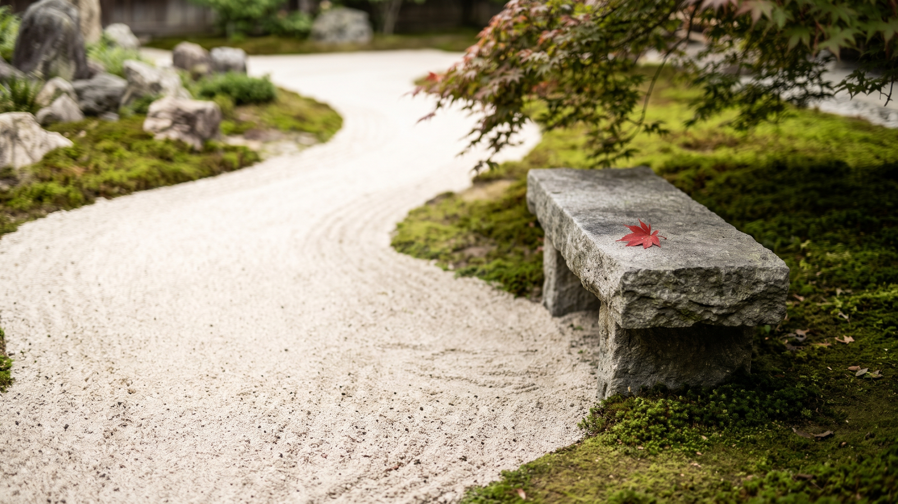

# Minimal-Reddit

> **LEFT UNTOUCHED** · Post pages, comment pages, the front page, user pages, and search pages are left alone. Only a subreddit root page is redirected, and only on `www.reddit.com`.

A small browser extension that sends you to a subreddit's wiki instead of its post feed.

## What it does

When you open a subreddit root page on `www.reddit.com`, such as `https://www.reddit.com/r/python/`, the extension redirects you to that subreddit's wiki index, `https://www.reddit.com/r/python/wiki/index`, keeping any query string on the original URL. That is all it does:

- Subreddit root pages (`/r/<name>` with or without a trailing slash) redirect.
- Post pages, comment pages, the front page, user pages, and search pages are left alone.
- Only `www.reddit.com` is covered: the manifest permission is `*://www.reddit.com/r/*`, so `old.reddit.com` and other Reddit hosts are not redirected.

## Install

Load the folder as an unpacked extension in a browser that still supports manifest version 2 extensions with the `webRequestBlocking` permission. The manifest declares `webRequest`, `webRequestBlocking`, and `tabs`.

## Verified behaviour and limits

Verified with a Node harness that stubs `chrome.webRequest` and drives the listener: root pages with and without a trailing slash redirect to the wiki index, a root page with a query string now keeps that query string (before this pass the query was dropped), post URLs and the front page return no redirect, and the manifest parses as JSON. The extension was not loaded in a real browser in this pass, so the browser-side permission behaviour is as declared in the manifest, not as observed. The extension name in the manifest previously read "Reddit Wiki Only"; it now matches the repo name.

Files: `background.js`, `manifest.json`, `logo.png`, `banner.png`.
